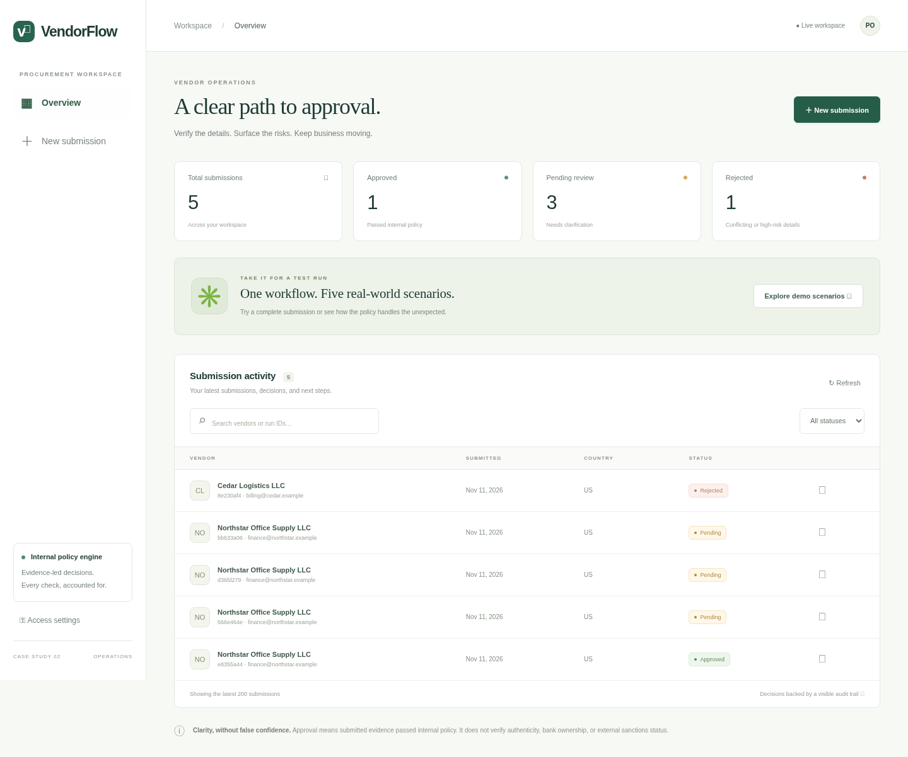

# VendorFlow

**Vendor onboarding, from submission to an explained decision.** A complete implementation of ASA Case Study PS-2: real form/JSON input, PDF/text evidence extraction, deterministic checks, approved/pending/rejected outcomes, vendor follow-up, live run stages, and persistent history.

No API keys, paid services, or AI account required. All examples are synthetic.

[Watch the recorded demo](docs/demo.mp4) · [Demo walkthrough](docs/DEMO.md) · [Validation evidence](docs/VALIDATION.md)



## Run locally

Requires Python 3.12+ on Linux/macOS (Windows: use WSL or Docker).

```sh
python -m venv .venv
.venv/bin/pip install -r requirements.lock
.venv/bin/python -m vendorflow.app
```

Open port **8000** in your browser. The default bind is loopback. A fresh installation starts empty. Select **New submission → Complete submission → Run onboarding checks**. Then run the four edge cases. Run **Shared account** after the happy path so there is an approved account to compare against. Re-running a previously approved tax identity correctly becomes pending rather than creating a duplicate vendor.

For a hosted runtime, mount a persistent data directory and run **one process worker**:

```sh
VENDORFLOW_DATA_DIR=/path/to/persistent/data \
VENDORFLOW_TOKEN='<set-a-long-random-secret>' \
.venv/bin/gunicorn 'vendorflow.app:create_app()' --bind 0.0.0.0:8000 --workers 1 --threads 4
```

Enter the configured token through **Access settings**. Do not commit secrets. Use TLS at your hosting provider/reverse proxy and configure its origin/host forwarding consistently. The token protects all APIs; static UI and `/health` remain public. Local no-token mode is intended for synthetic demonstrations only. An unauthenticated public deployment is not suitable for sensitive data.

### Docker

```sh
docker build -t vendorflow .
docker run --rm -p 127.0.0.1:8000:8000 -v vendorflow-data:/app/data vendorflow
```

The image runs as an unprivileged user. For external exposure supply `-e VENDORFLOW_TOKEN` from your environment, use TLS, and restrict access. Container deployment is supplied for portability; see [validation](docs/VALIDATION.md) for what was actually tested.

## What it does

1. **Intake** — validates contact details, required fields and country support.
2. **Evidence** — extracts text from uploaded PDFs or UTF-8 text; checks presence and document type. Documents need labeled fields; see the templates in the form and [examples](examples). Scanned/empty PDFs become pending. Malformed, encrypted, oversized or unsupported uploads produce an actionable input error.
3. **Company & tax** — US EIN (9 digits) or UK UTR (10 digits); compares name, country and tax ID with supporting evidence.
4. **Payment safeguards** — US ABA format/checksum and account length, or UK IBAN format/mod-97; compares legal name, payee and bank evidence.
5. **Compliance & history** — declaration entity, signatory, expiry and self-declared sanctions; detects existing approved tax identities and bank accounts shared by distinct identities.
6. **Decision & communication** — rejection takes precedence over pending; otherwise approve. Creates specific next steps and an in-app vendor message, available as a downloadable text follow-up. JSON reports contain checks, actual stage timestamps, evidence hashes and masked payment/tax references.

**Approval is an internal consistency decision, not proof of legitimacy or authorization to pay.** Evidence can be forged. The app does not contact banks, tax authorities or sanctions services. US EIN/UK UTR checks are format checks only; checksum validity does not prove an account exists. The sanctions field is a declaration, not screening. No automated external email is sent; the contact can be invalid or attacker-controlled. A procurement operator reviews/downloads the follow-up for delivery through a trusted channel.

## Prepared scenarios

| Scenario | Expected | What changes |
|---|---|---|
| Complete submission | Approved | All evidence and details agree |
| Missing & expired evidence | Pending | Missing tax evidence plus expired compliance; follow-up lists both |
| Third-party payee | Pending | Bank evidence agrees with payee but payee differs from legal entity |
| Invalid routing checksum | Pending | Submission and bank document agree, but routing checksum fails |
| Shared account | Rejected | Another tax identity uses the bank account of an approved vendor |

Additional tested policies include contradictory tax/bank evidence, declared sanctions, duplicate identity, unsupported country, UK IBAN, wrong document types and blank PDFs.

## API

```sh
curl -H 'Content-Type: application/json' \
  --data-binary @examples/01-happy.json http://127.0.0.1:8000/api/runs
# Returns 202 with a durable run ID. Poll the ID:
curl http://127.0.0.1:8000/api/runs/RUN_ID
```

Add `Authorization: Bearer ...` if token protection is configured.

| Endpoint | Purpose |
|---|---|
| `GET /health` | Process/database readiness |
| `GET /api/examples` | Five synthetic ready-to-run submissions |
| `POST /api/runs` | JSON `{submission, documents}` or multipart `submission` JSON and `tax`, `bank`, `compliance` files |
| `GET /api/runs` | Latest 200 summaries plus all-time status counts |
| `GET /api/runs/:id` | Masked result, stage events, document hashes, follow-up |
| `GET /api/runs/:id/report` | Downloadable JSON decision report |
| `POST /api/runs/:id/retry` | Retry a processing-error run only |

JSON evidence values are text strings keyed by `tax`, `bank`, and `compliance`. Uploaded documents take precedence over pasted text. Omitted documents are valid submissions that become pending. Each uploaded file is limited to 2 MB, PDFs to 10 pages, extracted text to 100,000 characters, and total HTTP body to 6 MB. Documents are read as data, never as instructions or executable content.

## Validate

```sh
.venv/bin/pip install -r requirements-dev.lock
.venv/bin/python -m pytest -q
# With a fresh server running on 8000; browser tests require Chromium:
CHROMIUM_PATH=/usr/bin/chromium .venv/bin/python tests/browser_smoke.py
```

If Chromium is unavailable, run `.venv/bin/playwright install chromium` and set `CHROMIUM_PATH` to its executable, or install Chromium through your OS package manager. Browser tests expect an empty database; use a disposable `VENDORFLOW_DATA_DIR`. They exercise the five scenario forms and real HTTP processing, downloads, history, filters and mobile layout. No simulated decisions or sleeps are used by the policy engine; fast runs may complete between UI polling intervals. The timestamped stages still reflect actual execution.

## Design, data & limitations

See [architecture and policy](docs/ARCHITECTURE.md), [demo walkthrough](docs/DEMO.md), and [validation evidence](docs/VALIDATION.md).

- Flask + plain JavaScript/CSS; no front-end build step or external asset dependencies.
- SQLite persists submissions, extracted evidence text, events, decisions and follow-ups. Original PDF bytes are not retained; SHA-256 hashes identify the input. No information is sent to third-party extraction services.
- **Raw tax and bank fields and extracted document text are retained in SQLite.** API/report outputs mask these fields, but the database is not encrypted. The directory/database are created with restricted permissions. Use encrypted storage, access controls and a retention policy before using real vendor data. Never commit the ignored `data/` directory.
- Single process, one processing queue: serializes duplicate lookup and decision commits. Do not use multiple workers, replicas or a Flask reloader against one database. SQLite is appropriate for this demonstration, not a distributed approval system.
- Queued/running jobs resume when the process restarts. Internal errors retain the submission and expose a retry action; data survives server restarts with a persistent volume. Stage events describe the latest processing attempt.
- Exact normalized names ignore punctuation and common legal suffixes. No fuzzy approval or probabilistic extraction. Structured documents are intentionally required to avoid guessing from arbitrary prose. Specialist review is required outside US/UK.
- No reviewer override, vendor identity login, real document authentication, OCR, external sanctions verification, email delivery, cryptographic signatures or immutable audit ledger. Those require scoped integrations and governance; the app makes no claim to provide them.

This repository contains the working project and synthetic demonstration materials. It does not submit anything to a hiring coordinator or claim a public deployment.
