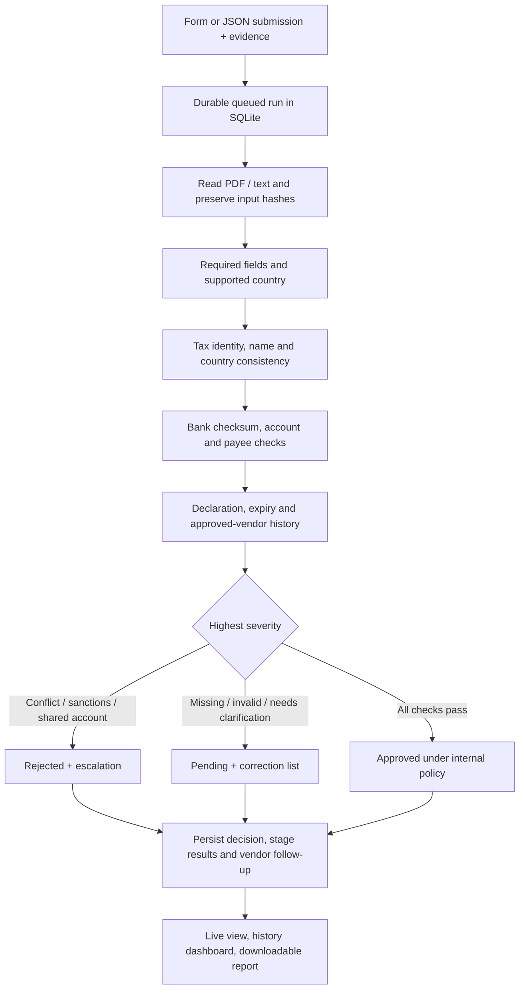

# Architecture and policy decisions

## Process map

The browser posts to Flask, receives a durable ID and polls real persisted stage events. A single background executor processes submissions, so closing the browser does not cancel a job. The engine is pure policy logic; tests inject a fixed date and prior approved records. Stage callbacks persist actual timestamps and findings. There are no timer-generated checks, simulated progress percentages, LLM calls or hard-coded scenario outcomes.

## Why deterministic rather than LLM extraction?

The highest-risk decisions here are bank-account and legal-identity comparisons. A deterministic, auditable policy is easier to explain and test, costs nothing to demo, and does not transmit tax/bank data to an AI vendor. The tradeoff is a deliberately constrained evidence format: labeled text extracted from text PDFs or submitted as UTF-8. Unreadable or incomplete evidence never gets a guessed approval. This is a working automation with explicit boundaries, not a claim to authenticate arbitrary documents.

## Severity policy

- **Rejected:** submitted tax identity conflicts with evidence, bank details conflict with evidence, self-declared sanctions exposure, or account reuse across different approved tax identities.
- **Pending:** missing/invalid details, unsupported country, absent/unreadable/wrong-type evidence, company or payee name mismatch, expired/unsigned/unclear compliance declaration, tax/country format errors, checksum failure, or an already approved tax identity.
- **Approved:** every applicable check passes.

Rejection wins if a run has both rejection and pending findings. Each finding exposes its rule code, stage, outcome, reason, and correction/escalation action. Rejection is a stop for this submission, not a permanent accusation or determination of fraud. A corrected submission can be submitted as a new run; this version has no reviewer override.

## Identity and duplicates

Name normalization ignores case, punctuation and common legal suffixes. It does not fuzzy-match unrelated names. The same tax ID in the same country is an existing identity and becomes pending. A bank account shared with another approved identity becomes rejected. Only approved historical records participate: unapproved submissions cannot poison the bank-account registry. US account identity includes routing and account number; UK identity uses whitespace-insensitive IBAN. Processing and approval commits are serialized in the supported **one-process-worker** deployment. No distributed consistency guarantee is made.

The prepared third-party-payee scenario is subtle: the form and bank evidence agree with each other, but the beneficiary differs from the tax/legal entity. The routing scenario also has agreeing evidence, but fails a mathematical payment check. The shared-account case only emerges by cross-referencing accepted historical records.

## State, recovery, access

SQLite stores payloads, extracted text, events and results. Queued and running rows are resumed on startup; completed decisions are retained. Error runs support explicit retry. Approval plus result is committed atomically. API output masks tax/account references and excludes raw evidence; audit hashes preserve the identity of input bytes without publishing them. Downloads contain only masked summary data and policy findings.

A configured bearer token gates every API. Browser mutating requests enforce same origin; the server does not enable CORS. Parameterized SQL, text-only document parsing, escaped UI rendering, a restrictive Content Security Policy, file/page/text limits and no third-party assets reduce common risks. Data at rest remains unencrypted and audit rows remain mutable by a database administrator. Public, regulated or multi-tenant use needs proper authentication/authorization, encryption/retention controls, stronger PDF parser isolation, rate limits, external verification and an append-only audit system.

## Explicit assumptions

- This is the buyer-side procurement workspace; vendor messages are generated in the result for trusted-channel follow-up, not emailed automatically.
- The supported local policies cover US EIN/ABA and UK UTR/IBAN only. No VAT validation or government registry lookup is claimed.
- A compliance declaration has a named signatory and stated expiry; no digital signature is authenticated.
- The machine's current date determines expiry. Test clocks are fixed for reproducibility.
- Stored history includes real executions over synthetic inputs. The first dashboard is empty; it is never prefilled with fictitious runs.
- Existing checkouts are used directly in isolated cloud tasks; no additional Git worktree is required.
